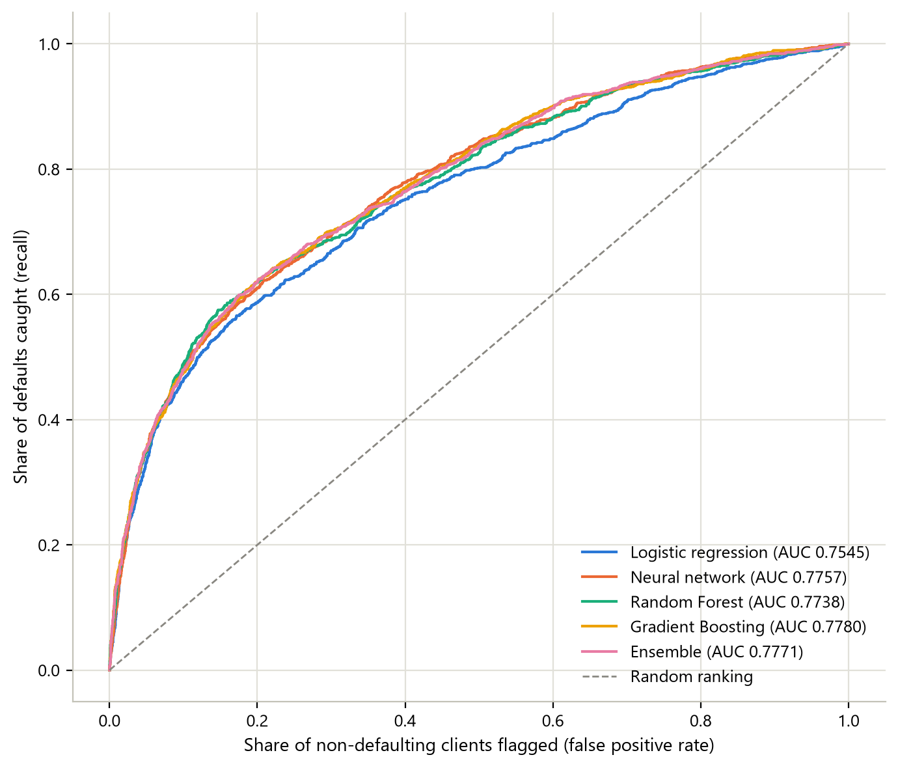
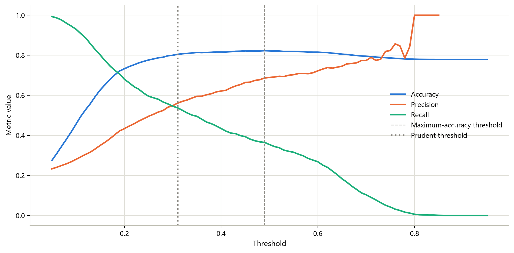
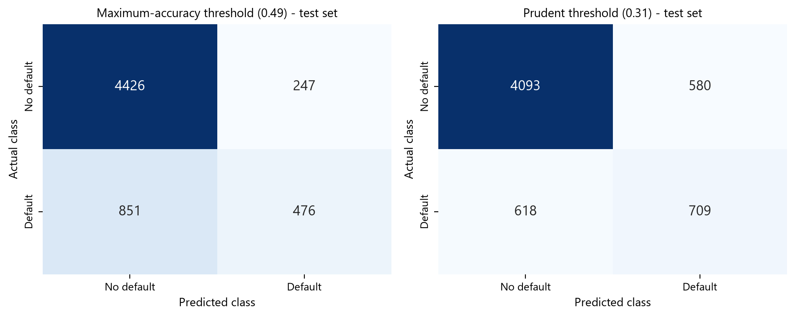

# Credit Card Default Risk

Predicting which credit-card clients will default next month. Five models are compared with a baseline that ignores the client, and the decision threshold is chosen so that a missed default weighs more than a false alarm.

**Authors:** [Simone Nardi](https://www.linkedin.com/in/simone-nardi-931259439) and [Thomas Petrera](https://www.linkedin.com/in/thomas-petrera-312850392)

**Project walkthrough:** [`index.html`](index.html) is a single self-contained page that explains the whole project step by step, with every figure and an interactive threshold explorer. View it through GitHub Pages, or download it and open it in a browser.

## Results at a glance

Measured on 6,000 clients that were never used to train a model or to make a choice (the test set):

| | Baseline | Final model (Random Forest) |
|---|---:|---:|
| Cross-entropy loss (lower is better) | 0.5284 | **0.4321** |
| ROC-AUC | 0.5000 | **0.7738** |
| Accuracy at the maximum-accuracy threshold (0.49) | 0.7788 | **0.8170** |
| Accuracy at the prudent threshold (0.31) | 0.7788 | **0.8003** |
| Share of defaults caught at the prudent threshold | 0.0000 | **0.5343** |
| Missed defaults at the prudent threshold | 1,327 | **618** |

The baseline gives every client the same probability, the default rate of the training set, so it predicts "no default" for everyone. It is right 77.88% of the time and catches no default at all, which is why accuracy alone is not enough to judge a model here.

<p align="center">
  
</p>
<p align="center"><em>ROC curves on the test set. Each point of a curve is one threshold: the share of good clients flagged by mistake (horizontal) against the share of defaults caught (vertical).</em></p>

## The question

The project has three parts:

1. **Estimate** the probability that each client defaults next month.
2. **Compare** five models with a baseline that uses no client information. A model is useful only if it beats that baseline.
3. **Decide**: turn the probabilities into "flag" or "do not flag". The two possible errors do not cost the same. A false negative is a missed default; a false positive is a false alarm on a good client. In credit, a missed default usually costs more.

## Data

The "Default of Credit Card Clients" dataset from the UCI Machine Learning Repository: 30,000 clients of a bank in Taiwan, observed from April to September 2005. The target is 1 if the client defaults in October 2005.

- 23 input variables: credit limit, sex, education, marital status, age, six months of repayment status, six statement amounts and six payment amounts.
- No missing values and no duplicate client IDs.
- 6,636 clients default (22.12%), so the classes are imbalanced.

## Method

1. **Variables.** The repayment codes become months of delay (`DELAY_k = max(PAY_k, 0)`). Sex, education and marital status become 0/1 indicators, with the undocumented codes grouped as "other".
2. **Split.** 60 / 20 / 20, stratified on the target with a fixed seed: 18,000 clients for training, 6,000 for validation and 6,000 for test, each with the same 22.12% default rate. Training fits the models, validation makes every choice, the test set is used once at the end.
3. **Features and scaling.** Among pairs of quantitative variables with a correlation of at least 0.70 in absolute value on the training set, the one from the older month is dropped (`BILL_AMT2` to `BILL_AMT6`, `DELAY_5`). 20 features remain. Payment amounts are log-transformed, and all quantitative features are standardised with the mean and standard deviation of the training set only.
4. **Models.** Logistic regression and a neural network (Keras, with early stopping), a Random Forest (500 trees), Gradient Boosting, and an ensemble that averages the four probabilities. Network size, leaf size and number of trees are chosen on the validation set. The final model is the one with the lowest validation loss.
5. **Threshold.** For each model two thresholds are chosen on the validation set: the one with the highest accuracy, and a *prudent* one, which has the fewest missed defaults among the thresholds that lose at most 2 accuracy points against the best and keep precision at 0.50 or more.
6. **Final check.** Every choice is fixed before the test set is touched.

## Results

### Choosing the model on the validation set

| Model | Validation loss | Validation accuracy (threshold 0.50) | Validation ROC-AUC |
|---|---:|---:|---:|
| Baseline | 0.5284 | 0.7788 | 0.5000 |
| Logistic regression | 0.4477 | 0.8173 | 0.7669 |
| Neural network | 0.4327 | 0.8202 | 0.7786 |
| **Random Forest (final model)** | **0.4259** | **0.8218** | **0.7861** |
| Gradient Boosting | 0.4291 | 0.8213 | 0.7802 |
| Ensemble | 0.4280 | 0.8212 | 0.7842 |

All five models beat the baseline. The Random Forest has the lowest validation loss and becomes the final model; the non-linear models differ by only a few thousandths.

### Choosing the threshold

<p align="center">
  
</p>
<p align="center"><em>Random Forest on the validation set. Accuracy is almost flat over a wide band, so the threshold can be lowered a little to catch many more defaults.</em></p>

For the Random Forest the maximum-accuracy threshold is 0.49 and the prudent threshold is 0.31. If the probabilities are reliable, a threshold of 0.31 is the right one when a missed default costs about 2.23 times a false alarm. The two tolerances of the prudent rule are design choices, not results; the notebook shows how the threshold moves when the accuracy tolerance changes.

### The final check on the test set

| Model | Test loss | Test ROC-AUC | Accuracy, maximum-accuracy threshold | Accuracy, prudent threshold | Recall, prudent threshold | Missed defaults, prudent threshold |
|---|---:|---:|---:|---:|---:|---:|
| Baseline | 0.5284 | 0.5000 | 0.7788 | 0.7788 | 0.0000 | 1,327 |
| Logistic regression | 0.4470 | 0.7545 | 0.8148 | 0.7960 | 0.4996 | 664 |
| Neural network | 0.4339 | 0.7757 | 0.8167 | 0.7988 | 0.5177 | 640 |
| **Random Forest (final model)** | 0.4321 | 0.7738 | 0.8170 | 0.8003 | 0.5343 | 618 |
| Gradient Boosting | 0.4309 | 0.7780 | 0.8182 | 0.8013 | 0.5079 | 653 |
| Ensemble | 0.4314 | 0.7771 | 0.8173 | 0.8013 | 0.5049 | 657 |

<p align="center">
  
</p>
<p align="center"><em>Random Forest on the test set at the two thresholds. Rows are the actual outcome, columns the prediction.</em></p>

- Moving from the maximum-accuracy threshold to the prudent one, missed defaults fall from 851 to 618 and recall rises from 0.3587 to 0.5343. In exchange, false alarms rise from 247 to 580 and accuracy goes from 0.8170 to 0.8003, still above the baseline.
- The behaviour seen on validation carries over to clients the models have never seen.
- The estimated probabilities can be read as risks: the observed default rate rises from 0.0643 in the lowest risk band to 0.6657 in the highest, close to the mean predicted risk of each band.
- The model relies mostly on recent payment delays, the September delay above all. Sex, education and marital status add almost nothing.

## Limits

- **Sample and period.** One bank in Taiwan, one period (2005), a one-month horizon. For another portfolio or another economic cycle the probabilities would have to be re-estimated.
- **Validation.** A single random split, no cross-validation: the choices depend partly on those 6,000 validation clients.
- **Hyperparameters.** Small grids: three networks, four leaf sizes for the forest, three leaf counts for Gradient Boosting.
- **Error costs.** The real costs of false alarms and missed defaults are unknown; the prudent threshold is a design rule, not the result of a cost calculation.
- **Margin over the baseline.** The features explain only part of client behaviour, so the gain over the baseline is moderate, and even at the prudent threshold some defaults go undetected.

## A note on method

All five models are evaluated on the test set for study purposes, to compare their behaviour across training, validation and test. In a real application only the model chosen on validation would be evaluated on the test set, once. The performance estimate of the project is therefore the Random Forest's.

On the test set Gradient Boosting is marginally ahead in loss and ROC-AUC. Choosing it now would mean using the test set for a decision and would make the estimate optimistic. Differences of a few thousandths are within sampling variability: on validation the Random Forest was ahead.

## Repository contents

| File | Content |
|---|---|
| `rischio_di_credito_cinque_modelli_v2.ipynb` | The full analysis: code, outputs and comments. The comments are in Italian; the walkthrough covers the same content in English. |
| `index.html` | The project walkthrough in English, one self-contained page. |
| `figures/` | The figures shown in this README. |
| `default of credit card clients.xls` | The dataset, as distributed by the UCI Machine Learning Repository under the [CC BY 4.0](https://creativecommons.org/licenses/by/4.0/) licence (see the data source below). |

## How to run

1. Install Python and the libraries:

   ```bash
   pip install numpy pandas scikit-learn tensorflow matplotlib seaborn xlrd notebook
   ```

2. Keep the dataset file `default of credit card clients.xls` in the same folder as the notebook, which reads it from there.
3. Open the notebook and run all cells. It takes a few minutes on a laptop CPU.

Random seeds are fixed at 42. The numbers above were obtained with Python 3.13, TensorFlow 2.21 (Keras 3.15), scikit-learn 1.9, pandas 2.3 and NumPy 2.5; the neural-network results can differ slightly with other versions or hardware.

## Data source

Yeh, I-C. (2009). Default of Credit Card Clients [Dataset]. UCI Machine Learning Repository. https://doi.org/10.24432/C55S3H. Licensed under [Creative Commons Attribution 4.0 International (CC BY 4.0)](https://creativecommons.org/licenses/by/4.0/). The data file is included as distributed; the derived variables are created in the notebook.

Yeh, I-C., & Lien, C-H. (2009). The comparisons of data mining techniques for the predictive accuracy of probability of default of credit card clients. *Expert Systems with Applications*, 36(2), 2473–2480.
